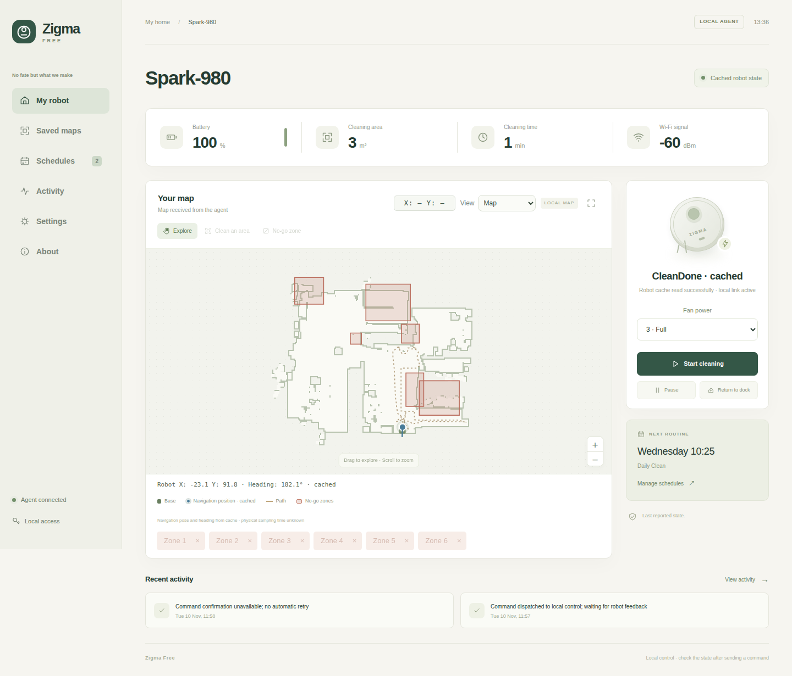
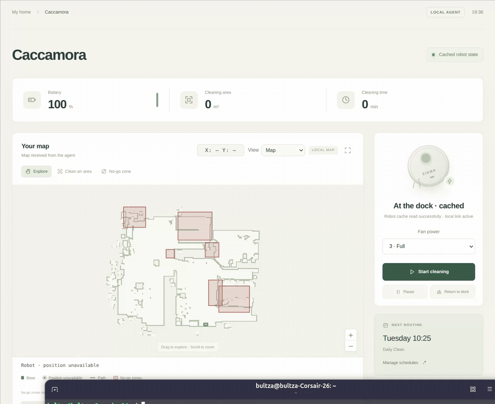
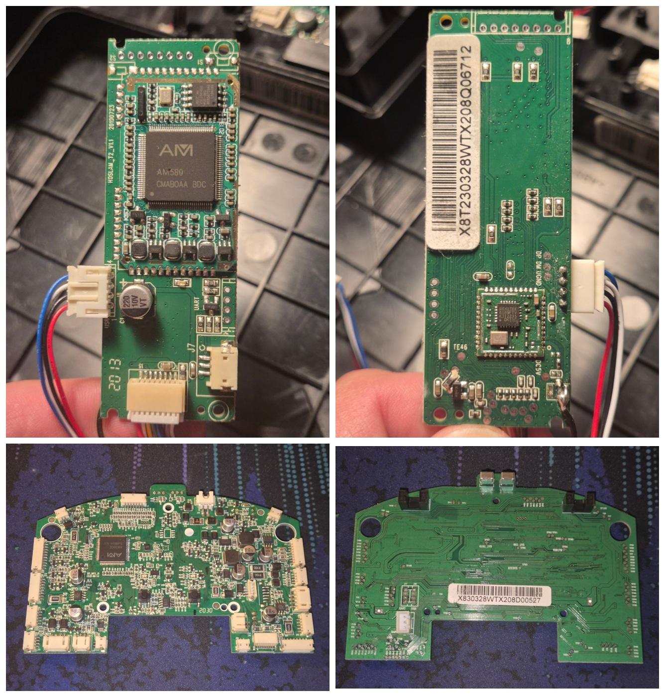
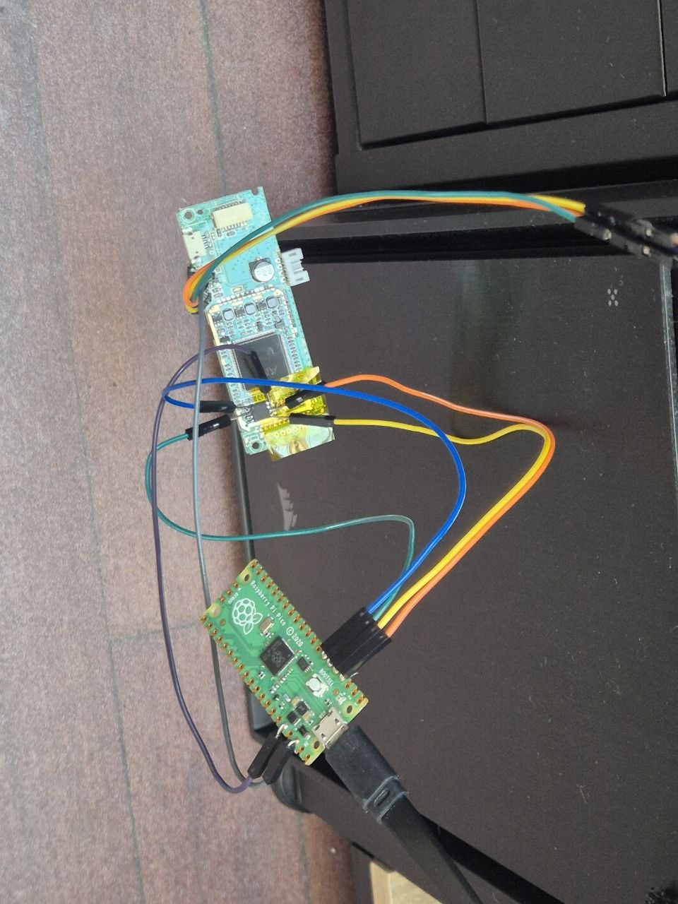

# Zigma Free

In August 2026, all Zigma Spark-980 robots lost its WiFi connectivity all over the world. During the investigation, we captured a command delivered through the cloud service that disables the Wi-Fi on the robot (an auto destruct command!). A similar loss of app control affected the Redmond RV-R670S in October, when we found expired TLS certificates on the service's HTTPS endpoints. [Skip to how we discovered access](#how-we-discovered-access) if you’re here for the hack.

If you just want to install it on your Zigma (or Redmond or Puron) robots, go directly to the [Installation Manual](installer/README.md)

The Zigma Spark-980 is a robot vacuum cleaner that uses a LiDAR laser scanner to map your home and navigate as it cleans. It returns to its charging dock on its own and was originally controlled through a mobile app that relied on the manufacturer's cloud service.

I started building Zigma Free to get my robot back under my control and make it easier to use. More than anything, I wanted it to clean my house every day on its own again.

With Zigma Free, you can control the vacuum from a web browser on your local network, over SSH, or through a Telegram bot when you're away from home. Everyday control works independently of the manufacturer's cloud. The live LiDAR view shows what the robot's laser scanner detects.

Daily cleaning schedules run on the robot's own clock, so they work even without Wi-Fi. If the robot loses track of time after being powered off, set the clock again so cleaning starts at the right time.

## Model compatibility

Zigma Free was developed and tested on the **Zigma Spark-980**.

### Potentially compatible models

- **Redmond RV-R670S**
- **Redmond RV-R650S**
- **Puron PR10**

We used the RV-R670S profile in the REDMOND Robot app to pair a Spark-980. All three models are listed as using the same replacement roller brush as the Spark-980. Zigma Free installation is unverified on these three models.

## Features

The web interface and control software run on the robot itself. The original navigation software still handles driving and cleaning. Telegram is optional and requires an internet connection.

- Run weekly cleaning schedules locally using cron.
- Start, pause, or resume cleaning, or send the robot back to its dock.
- View the current map, manage saved maps, and see live LiDAR readings.
- Adjust voice volume and manage voice prompts.
- Access the robot over SSH or control it remotely through Telegram.

## Zigma Spark-980 hardware
During the investigation we used 3 different robots, the three of them with different versions and in at least one, a totally different linux partition. This makes it particularly difficult because even if they use the same hardware, in some of the robots the internal storage has a permanent change applied that is not compatible with the kernel of other robots.

The robot has two main PCBs. The **AM580 main logic board** runs Linux, and the **AM380 chassis controller board** handles low-level chassis control.

- **Processor and RAM:** Amicro AM580 (`amicro,am580`). and 64 MiB of DRAM.
- **Storage:** 32 MiB (256 Mbit) of Macronix SPI NOR flash, identified as MX25L25635F/MX25L25645G.
- **Wi-Fi:** 2.4 GHz Wi-Fi via SDIO. The stock Linux kernel uses the Realtek `rtl8189fs` driver.
- **UART:** The main board exposes a 3.3 V TTL serial console at 115200 baud, 8N1, with no flow control. The stock software takes over the console during boot.

*AM580 main logic board in the top row and AM380 chassis controller board in the bottom row. Top views are on the left and bottom views on the right.*

## How to install

> [!WARNING]
> Installing Zigma Free can leave your robot unable to boot or operate. The risk appears low on supported Spark-980 firmware when you follow the guide, but a mistake or a power interruption at the wrong time can still brick the robot. Check your firmware, keep the robot powered during installation, and stop if the wizard cannot verify the flash backup. Proceed only if you are prepared to recover the robot.

On a Windows or Linux computer with Python 3.10 or later, download and extract the [latest release package](https://github.com/bultza/zigma-spark-980-free/releases). Then follow the detailed instructions from here: [Install Zigma Free](installer/README.md)

> [!WARNING]
> Building from source is an advanced option. For most users, we recommend the release package above. If you want to build it yourself, follow the [manual build instructions](src/README.md).

## Instructions and troubleshooting

See [Instructions and troubleshooting](USAGE.md) for how to use your brand new robot, how to add SSH public keys after installation and recover access if you move house or lose your old computer.

## How we discovered access

We started with the UART console. It let us watch the robot boot, but the factory debug server took over the serial port before we could get a shell. So we wired a Raspberry Pi Pico to the SPI flash, read the memory, and modified the writable partition to start the robot's built-in SSH server.

Later, we worked out how to unlock the UART console and found an easier way to get SSH without opening the robot. The factory Wi-Fi pairing process could download and run a script from a computer on the local network. Once we had shell access, we captured the cloud command that deleted the robot's Wi-Fi settings. We called it the “auto-destruct” command.

[How we hacked it](hack/HISTORY.md) tells the full story, from the wires on the bench to local control.

## Plan for the future

The long-term goal is to replace the factory operating system and proprietary binaries with an open-source software stack that can run the robot independently.

The table tracks the main factory executables and their replacement status in Zigma Free local mode.

| Factory executable | What it does | Status |
| --- | --- | --- |
| ~~`ygclient`~~ | Sets up Wi-Fi and cloud registration, translates commands and telemetry, publishes maps and cleaning history, and handles cloud updates. Its replacement needs to cover the local functions that the rest of the robot expects. | Replaced in local mode by the Zigma Free agent and network services. |
| `wifi_app_server_grit` | Interprets high-level commands and forwards them to the navigation process. It also handles settings, voice prompts, and reports about robot state and maps. | Still in use. |
| `demo_rplidar` | Runs the HOSLAM navigation stack. It processes LiDAR scans, builds maps, estimates the robot's position, and handles navigation and calibration. | Still in use. |
| ~~`daemon`~~ | Monitors and restarts factory processes and coordinates recovery and reboot operations. | Replaced in local mode by the Zigma Free supervisor. |
| `upgrade380` | Updates the firmware on the AM380 chassis controller. | Replacement pending. |
| `factory_mode` | Provides factory test and service functions. It also participates in factory update handling. | Replacement pending. |
| `rescue` | Provides a factory recovery path that the supervisor can launch. It also participates in factory update handling. | Replacement pending. |

Zigma Free disables both factory executables (ygclient and daemon) in local mode.

The Linux boot stack is a separate part of the roadmap. It includes U-Boot, the kernel, the device tree, and the Buildroot userspace. The AM380 controller also has its own firmware, separate from the Linux executables. Replacing that firmware requires documenting how the controller talks to the main board and validating the resulting motor and sensor behavior on the robot.

The plan is to replace components in stages and test cleaning, mapping, docking, and recovery after each major change.

## Extra Guides
- [Manual hack](hack/MANUAL-HACK.md) explains how to enable and verify SSH access on your own robot.

## License

Zigma Free's original software is available under the [MIT License](LICENSE). Third-party components retain their own licences. See the notices for [cJSON](src/robot/vendor/cjson/LICENSE) and [Mbed TLS](src/robot/vendor/mbedtls/LICENSE). New deployment archives also include the [third-party notices](src/robot/vendor/notices/README.md) for musl, the GCC runtime, and the Telegram transport and CA bundle.
