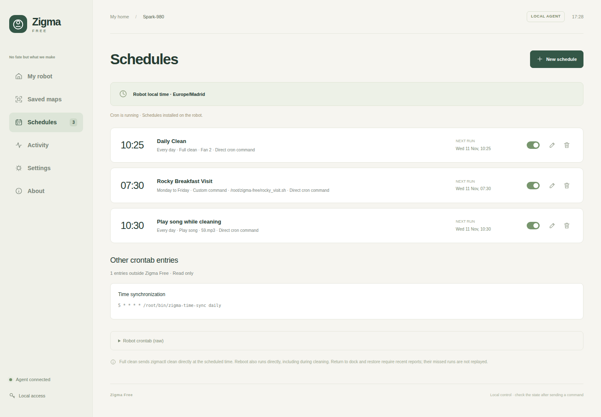
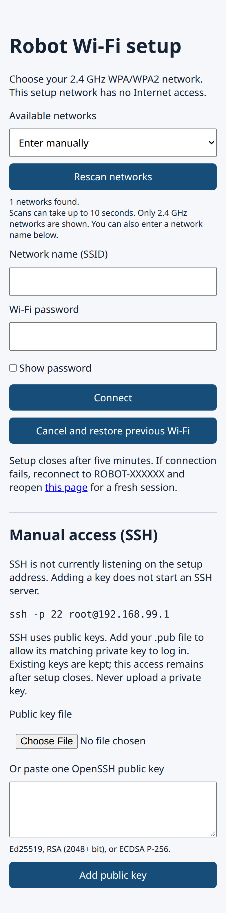

# Instructions and troubleshooting

## Restart the robot over SSH

> [!WARNING]
> ⚠️ Avoid running the plain Linux `reboot` command over SSH. Use `/root/bin/zigmactl reboot`. The robot will recover internet but might lose all mobility capabilities and you will need to manually powercycle it.

Use `/root/bin/zigmactl reboot` when you need to restart the robot over SSH. A plain Linux `reboot` restarts the main processor while the separate AM380 chassis controller can keep running. The two processors can then come back out of sync. `zigmactl reboot` runs `/root/bin/hold380` to hold the AM380 in reset and restarts Linux only if that step succeeds. Your SSH session will disconnect during the restart.

## Connect over SSH

Run this on your computer. Replace `ROBOT_IP` with the robot's local IP address and use the private key that matches the public key you added:

```sh
ssh -i ~/.ssh/zigma -o IdentitiesOnly=yes root@ROBOT_IP
```

If you are using the original key from the installation wizard, use the path to `zigma_key` from the session's `connection.txt` in place of `~/.ssh/zigma`. On the first connection, check that the address belongs to your robot before accepting its host key.

## Use zigmactl

On the robot now you have a new tool to command your robot. Run these commands in the robot's SSH shell. If `zigmactl` is missing from the shell's path, use `/root/bin/zigmactl`.

| Command | What it does |
| --- | --- |
| `zigmactl --version` | Prints the installed version. |
| `zigmactl check-control` | Checks that the local control queue is available without sending a command. |
| `zigmactl clean [1-3]` | Starts cleaning. The optional suction level is 1 for Quiet, 2 for Normal, or 3 for Strong. The default is 3. |
| `zigmactl resume [1-3]` | Resumes cleaning using the same suction levels and default. |
| `zigmactl pause` | Pauses the current activity. |
| `zigmactl dock` | Sends the return-to-dock command and returns after dispatch. |
| `zigmactl dockblock [timeout_s]` | Sends the return-to-dock command and waits for confirmed charging at the dock. |
| `zigmactl goto x y` | Sends the robot to a point in the current map and returns after dispatch. Coordinates are integer cells relative to the map origin. |
| `zigmactl gotoblock x y [timeout_s]` | Sends the robot to a point and waits for confirmed arrival. |
| `zigmactl getvolume` | Reads the current speaker volume. |
| `zigmactl setvolume 0-100` | Sets the speaker volume and waits for confirmation. |
| `zigmactl reboot` | Restarts the robot using the coordinated sequence above. |

The blocking navigation commands default to a 300-second timeout and accept 10 to 3,600 seconds. A successful nonblocking command confirms dispatch. For `goto` and `dock`, check the robot's status to see whether it arrived. The experimental `setheadingblock` command reports that absolute heading control is unsupported and sends no movement.

## Web interface

Open `http://ROBOT_IP:8765` in your browser. Replace `ROBOT_IP` with the robot's local IP address and keep the port number. For example, `http://192.168.1.28:8765`.

The pages are labelled in the interface. Here's what you'll find on each one.

- **My robot** shows the current status, cleaning controls, and map views. [Desktop screenshot](images/zigma-free-dashboard-desktop.png) · [Mobile screenshot](images/zigma-free-dashboard-mobile.png)
- **Saved maps** lets you view robot maps and manage master copies. [Desktop screenshot](images/zigma-free-saved-maps-desktop.png) · [Mobile screenshot](images/zigma-free-saved-maps-mobile.png)
- **Schedules** lets you set weekly cleaning routines. [Desktop screenshot](images/zigma-free-schedules-desktop.png) · [Mobile screenshot](images/zigma-free-schedules-mobile.png)
- **Activity** shows recent events and cleaning reports. [Desktop screenshot](images/zigma-free-activity-desktop.png) · [Mobile screenshot](images/zigma-free-activity-mobile.png)
- **Settings** covers the robot's name, time, audio, SSH keys, web password, and Telegram. [Desktop screenshot](images/zigma-free-settings-desktop.png) · [Mobile screenshot](images/zigma-free-settings-mobile.png)
- **About** lists installed components and their versions. [Desktop screenshot](images/zigma-free-about-desktop.png) · [Mobile screenshot](images/zigma-free-about-mobile.png)

## Telegram

To set up Telegram notifications and remote control, follow [Telegram setup in the installation guide](installer/README.md#telegram-setup).

## Custom schedule examples

Here are two things Ciccio does at home. Both run from the robot's own schedule.



### Play a song while cleaning

> [!WARNING]
> ⚠️ The robot has very little free storage. Several full-length MP3s can fill it. Check the available space before copying music and keep only the tracks you need.

Set up a **Full clean** schedule and a separate **Play song** schedule a few minutes later. On Ciccio, cleaning starts at 10:25 every day and the song starts at 10:30. Pick an upbeat MP3 and put it in `/root/zigma-free/songs/` so you can select it when creating the schedule. The track in the screenshot is `59.mp3`. Playback runs at the scheduled time, even if the cleaning job has already stopped. In this case I have a single 3MB song on the robots, however I will change it so our server (franky) every mornign will upload a random song from a local pool and upload it to a fix path on the robots RAM memory.

### Send Rocky to breakfast

On weekdays at 07:30, Ciccio goes over to say hello to our kids at breakfast. It picks one of about 60 audio clips from its songs folder, including greetings in Rocky's voice from *Project Hail Mary*, then returns to the dock. The MP3s are local files on the robot.

In **Schedules → New schedule**, select **Custom command** and enter `/root/zigma-free/rocky_visit.sh`. The script below is the one running on Ciccio. Its destination, `-66 34`, is specific to our map. Choose a point in your own map and verify it with the robot in view before scheduling the visit. The script calls `play_random_song.sh`, which picks one MP3 from the songs folder and plays it with `/root/bin/audio_player`. The robot will make everything in silence except the random salute (that is why we get the volume and set it to zero, we restore the audio level when the script ends after docking).

```sh
#!/bin/sh
# Send Caccamora to a location, play a random sound, and return to dock.
# Assumes: zigmactl getvolume/setvolume/gotoblock/dockblock are available.

set -eu

ZIGMACTL=${ZIGMACTL:-/root/bin/zigmactl}
PLAYER=${PLAYER:-/root/zigma-free/songs/play_random_song.sh}

# Accept e.g. "55", "volume: 55", or "VOLUME=55".
raw_volume=$($ZIGMACTL getvolume)
original_volume=$(printf '%s\n' "$raw_volume" | sed -n 's/.*[^0-9]\([0-9][0-9]*\)[^0-9]*$/\1/p; /^[0-9][0-9]*$/p' | tail -n 1)
case "$original_volume" in
  ''|*[!0-9]*) echo "Cannot parse volume from: $raw_volume" >&2; exit 1 ;;
esac

echo "Original volume: $original_volume"
restore_volume() {
  "$ZIGMACTL" setvolume "$original_volume" || echo "WARNING: failed to restore volume" >&2
}
trap 'restore_volume' EXIT
trap 'exit 130' INT
trap 'exit 143' TERM

"$ZIGMACTL" setvolume 0
sleep 5
#"$ZIGMACTL" gotoblock -60 -34
#sleep 10
"$ZIGMACTL" gotoblock -66 34
echo "Setting volume to loud."
"$ZIGMACTL" setvolume 100
echo "Playing random greetings"
"$PLAYER"
"$ZIGMACTL" setvolume 0
echo "Going back home"
sleep 2
"$ZIGMACTL" dockblock
sleep 10
# Original volume is automatically restored by EXIT trap.
```

## Add an SSH key after installation

On your new computer, generate an SSH key pair. ECDSA P-256 works with the Dropbear server used by the installer.

```sh
ssh-keygen -t ecdsa -b 256 -f ~/.ssh/zigma
```

Sign in to the Zigma Free dashboard and open **Settings → SSH public key**. Upload `zigma.pub` and click **Save**. This adds the new key alongside your existing keys. Keep the private key (`zigma`) on your computer.

Test the key by [connecting over SSH](#connect-over-ssh).

## Recover access after moving or changing computers

If the robot still tries to join your old Wi-Fi and you no longer have your old SSH key, use the local pairing portal on the robot. You don't need to hack the robot again.

1. Hold the robot's Wi-Fi pairing button.
2. On your phone or computer, join the `ROBOT-XXXXXX` (the suffix is a six-digit hexadecimal value derived from the robot’s Wi-Fi interface) network and stay connected even if it reports no internet access.
3. Open `http://192.168.99.1`. Add the new computer's SSH public key under **Manual access (SSH)** and click **Add public key**. The portal shows whether SSH is listening. Adding a key leaves the existing keys in place and does not start SSH if its server is down.
4. Select your new 2.4 GHz Wi-Fi network, or enter its name manually, and submit its password. The setup network disappears while the robot tries to connect. If the attempt fails, reconnect to the setup network and reload the portal.
5. Rejoin your home Wi-Fi, find the robot's new IP address in your router's DHCP leases, and test SSH with the new key. The dashboard is at `http://ROBOT_IP:8765`.



The pairing portal requires Zigma Free local mode. If the robot opens the factory pairing network instead (ROBOT#####), you will need to go to the [Manual hack](hack/MANUAL-HACK.md) for the factory pairing procedure. If factory pairing is unavailable, the [UART recovery method](hack/HISTORY.md#getting-the-uart-console-back) and the [original SPI flash method](hack/HISTORY.md#we-read-the-flash-and-added-ssh) are documented in the history.
