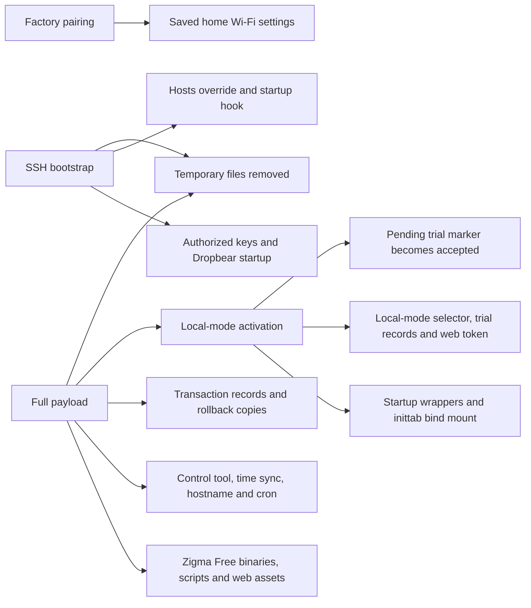

# Installer internals and build

For the installation steps, see [Install Zigma Free](README.md).

## Computer scripts

| Script | What it does |
| --- | --- |
| `install-from-linux.sh`, `install-from-windows.cmd`, `run-windows.cmd` | Start the wizard and prepare its Python environment using `requirements-wizard.txt`. |
| `upgrade-from-linux.sh`, `upgrade-from-windows.cmd` | Start the SSH managed-runtime updater without pairing or Wi-Fi switching. |
| `run-linux.sh`, `run-windows.cmd` | Prepare the shared Python environment. |
| `wizard.py` | Checks the package and network, guides pairing, verifies SSH access, and runs the local-mode activation checks. |
| `installer.py` | Builds the per-robot installation script and payload. It reads `known-firmware.json` to generate the firmware checks. |
| `send_pairing.py` | Builds and sends the pairing request that tells the robot where to download the installer. |
| `hosts_guard.py` | Uses SSH to apply the robot-side hostname overrides. |
| `nor_backup.py` | Downloads the flash backup and verifies it against a second read. |
| `session_recovery.py` | Continues an interrupted installation using its saved session. |
| `console_output.py`, `ssh_output.py` | Format console and SSH diagnostics. |

These files live in [computer/](computer/) and run from the extracted deployment archive. The launchers create `.wizard-venv/` beside the scripts, and the wizard saves session files under `~/Zigma/`.

## Robot scripts

Source paths are relative to [robot/](robot/). Entries in `bundle.tar.gz` are relative to the archive root. On the overlay layout, the stack is stored under `/root/firmware/arobot/zigma-free` and exposed at `/root/zigma-free`.

| Source script | Source package or transfer | Target on the robot | What it does |
| --- | --- | --- | --- |
| `install.sh.in` | Generated as `install.sh` for SSH bootstrap, then as `full-install.sh` on the computer for the full stage | The factory downloader runs the bootstrap script. The wizard uploads the full script as `/tmp/zigma-full.*/install.sh`. | Checks firmware and storage, enables SSH, and stages the full installation on compatible firmware. |
| `activate.sh` | `bundle.tar.gz` → `stack/activate` | `/root/zigma-free/activate` | Starts and checks the local-mode trial and handles acceptance or rollback. |
| `storage.sh` | `bundle.tar.gz` → `init/S02zigma-storage` | `/root/etc/init.d/S02zigma-storage` on the overlay layout | Sets up the storage paths used by Zigma Free. |
| `configure-support.sh` | `bundle.tar.gz` → `support/configure-support.sh` | Sourced from `/tmp/zigma-install.*/payload/support/` during installation | Installs supporting startup hooks and tools from the payload. |
| `vendor-hosts.sh` | Embedded in the entry script; also uploaded over SSH by `hosts_guard.py` | Runs as `/tmp/zigma-hosts-pc.*/apply.sh`. Writes persistent files under `/root/.zigma-hosts/` and the hook `/root/etc/init.d/S03zigma-hosts`. | Applies and persists overrides for known vendor hostnames. |
| `init/S98zigma-free` | `bundle.tar.gz` → `init/S98zigma-free` | Staged under `/root/zigma-free/install-init/`, then installed at `/root/etc/init.d/S98zigma-free` during activation | Starts the Zigma Free services. |
| `init/S01time`, `init/S03zigma-hostname`, `init/S96ntpsync`, `init/S97crond` | `bundle.tar.gz` → `support/` with the same filenames | `/root/etc/init.d/` | Boot hooks for time, hostname, network time sync, and cron. |
| `src/zigma-cron`, `src/zigma-free-service`, `src/zigma-mode`, `src/zigma-mode-backend`, `src/zigma-settings` | `bundle.tar.gz` → `stack/` with the same filenames | `/root/zigma-free/` | Scheduling, service supervision, mode switching, and settings. |
| `src/zigma-time-sync` | `bundle.tar.gz` → `support/zigma-time-sync` | `/root/bin/zigma-time-sync` | Synchronises the robot's clock. |

## Firmware profiles

The flash layout determines how the installer mounts and stages the stack. The firmware profile is selected independently by the layout and the SHA-256 hashes of the kernel and rootfs. The catalog contains original direct profiles (kernels #20 and #16), an overlay profile (kernel #23), and separately identified Issue01b/Issue03 direct hybrids with Ciccia kernel #23. A known base still has to pass the corresponding profile's component checks. An unrecognized base or a failed required check limits the installer to compatible persistent SSH.

The `ciccio-original-kernel20` base also accepts two explicitly catalogued native pairs: the complete Puron app-server/navigation pair, and the Puron app-server with original navigation. These permit Tools and Full after every other required firmware check passes. The `ciccia-original-kernel23` overlay base also accepts the complete Puron pair found in issue 01a. It retains the existing overlay storage path under `/root/firmware/arobot/zigma-free` and its bind-mount startup hook. The exceptions are scoped to these catalogued bases; the kernel #16 base retains its existing checks. Unknown or unreadable pairs still fall back to SSH-only. The packaged observer supports live LiDAR for the complete Puron pair. No vendor executable is replaced by accepting its hash.

Run the generated-shell firmware checks offline with:

```sh
PYTHONDONTWRITEBYTECODE=1 python3 -m unittest discover -s installer/tests -p test_firmware_checks.py -v
```

Each profile supplies the Wi-Fi executable directory and library search path. The installer records the selected profile in `installer-firmware` in the staged stack. The mode coordinator and its backend use the same record to run the network service and identify the vendor supplicant. Legacy installations without the record retain the original paths.

### Issue 01b and the Ciccia test hybrid

`direct-kernel16` identifies the original issue 01b firmware. The separate
`ciccia-hybrid-01b-kernel23` profile identifies the test image with the same
direct layout and userspace, but Ciccia's exact DTB, kernel #23 and Wi-Fi module.
Both retain `/usr/bin` Wi-Fi executables and `/usr/lib:/lib` library paths.
The hybrid is a test configuration, not an additional original vendor firmware.
Its Full installation, local-mode activation, SSH, authenticated web and installed
component hashes were verified on Ciccia. Physical cleaning and cold-boot
persistence remain untested; this does not validate the original kernel #16's
flash-writing behavior. No vendor binaries are replaced by these profiles.

Issue 01b's BusyBox provides gzip but its tar lacks `-z`. The installer verifies
the compressed bundle, runs `gzip -d`, extracts with `tar -xf`, and checks the
payload manifest before starting a transaction. Its temporary-space check reserves
room for the uncompressed TAR as well as the extracted payload.

### Timezones on firmware without zoneinfo

Full installations carry the checked-in timezone database under
`/root/zigma-free/share/zoneinfo` (tzdata version in `robot/zoneinfo/VERSION`,
license and per-file SHA-256 manifest alongside it). Packaging validates that
manifest and includes the files in the normal payload integrity checks and space
calculation. SSH-only and Tools do not install this database.

The agent and observer use absolute TZif paths. Settings persist the selected
zone as `/root/etc/localtime`; the settings adapter and managed cron explicitly
use that file through `TZ`. This works when `/usr/share/zoneinfo` and
`/etc/localtime` are absent on a read-only root filesystem, without modifying
that filesystem. Existing system zones remain a fallback for installations
without the bundled database. Selecting a zone does not set the UTC clock.

On Ciccia's issue01b hybrid, the menu exposes 419 zones. API changes to Madrid,
New York and UTC, winter/summer offsets on the robot, cron's inherited TZ and
all installed component hashes were verified. UTC was restored after testing;
a physical power cycle was not performed.

## Compiling and packaging

See [src/README.md](../src/README.md) for the toolchain, per-component build commands, and Telegram transport build. Run `python3 src/package-release.py --label dev` from the repository root after building both sets of binaries.

The packager puts the ARM executables and transport assets in `robot/build/`, third-party notices in `robot/vendor/`, the version inventory in `robot/versions.json`, and web assets in `web/src/` inside the archive. It writes ZIP and TAR.GZ archives with SHA-256 sidecars. The wizard checks the internal `SHA256SUMS` before starting an installation.

The deployment archive exposes `install-from-windows.cmd` and `install-from-linux.sh` at the top level. They delegate to the launchers under `computer/`.

### Early vendor hostname protection

The generated entry script embeds the same `vendor-hosts.sh` used by the computer.
After preflight, the install lock and pending-transaction checks, it applies and
verifies all 16 domains before downloading a Tools/Full payload or starting the
SSH installation transaction. This also covers an unknown-firmware fallback to
SSH. `--check` does not apply hosts. A hosts failure prints a warning and installation continues, including SSH and
Full. This applies to pre-pairing, the entry script, post-SSH and recovery checks.
Other installer checks (including pending transactions) remain independent.
Protection is retained if a later installation
step fails; it is not rolled back with SSH or Full files.

The pre-pairing SSH attempt and post-SSH verification remain in place. The initial
Wi-Fi connection before the robot downloads its entry script is still unprotected
when pre-pairing SSH cannot be used. Direct-IP traffic and existing connections
are outside the scope of hosts overrides.

## Full installation walkthrough

This is the sequence for a new installation with the Windows or Linux wizard. Commands and paths in this section describe what the wizard runs automatically.

### 1. Check the package and prepare the session

The launcher creates or reuses a Python virtual environment and installs the required dependencies if they are missing. The wizard verifies the distribution files against `SHA256SUMS` and looks for exactly one usable home Wi-Fi IPv4 address. It saves the network profile so the computer can reconnect after visiting the robot's pairing network. The address also goes into the download URLs sent to the robot.

For a new installation, the wizard asks for a robot name, Wi-Fi network, and password. It creates a timestamped folder under `~/Zigma`, generates an ECDSA P-256 SSH key pair, and saves two scripts and the full payload. The first script requests the SSH-only profile. The second requests the full profile and contains the expected payload SHA-256. The payload carries a checksum list for its individual files.

### 2. Start the local server and pair the robot

The wizard serves the SSH entry script and the full payload on TCP port 8000 by default. It supports HTTP and HTTPS on that port and checks that both return the expected entry script locally. The server stays available while the computer switches Wi-Fi networks.

When the computer joins the robot's pairing access point, the wizard checks whether SSH is already available at `192.168.99.1`. If a saved session has a matching pinned host key and can authenticate, the wizard applies the vendor hostname overrides before pairing. Otherwise, it reports that those overrides will be applied after SSH is set up. A first home Wi-Fi connection can therefore happen before the overrides are in place.

The wizard sends one pairing request using the Redmond profile. The request supplies the home Wi-Fi settings, the entry script URL, and the script's MD5 for the factory downloader. The computer returns to its saved home Wi-Fi profile, and the wizard waits for its original IPv4 address. It identifies the robot from the peer that downloads the entry script. It stops if more than one peer downloads it.

### 3. Enable and verify SSH

The downloaded script runs on the robot. It checks the ARM environment, the boot chain, Dropbear, and persistent storage. It takes an installation lock, records a pending transaction, adds the session public key alongside any existing keys, and installs the Dropbear startup hook. It starts SSH and records the completed profile.

The computer authenticates using the new key, pins the robot's host key, and checks that the transaction completed. It saves the SSH address in `connection.txt`. It then uploads and verifies `vendor-hosts.sh` over SSH. The script preserves the original hosts file and installs persistent loopback overrides for known vendor hostnames. Direct IP connections remain possible.

### 4. Back up the flash

Over pinned SSH, the wizard uploads a temporary NOR reader and verifies its SHA-256 before running it. The reader streams the complete 32 MiB flash image. The wizard saves the first read and compares it against a second complete read. On success, it keeps `nor-backup.bin` and `nor-backup.json` in the session folder. This live backup includes the SSH and hostname changes made by the earlier stages.

If the reads differ, the wizard can repeat both reads from the beginning. If verification still fails, it keeps any captured bytes marked as unverified. The default is to stop. Continuing without a verified backup requires explicit confirmation and working pinned SSH. The firmware checks still apply.

### 5. Stage the full installation

The wizard uploads the full installer over SSH to a temporary directory and verifies the script's SHA-256 before running it. The script checks the flash layout, firmware hashes, mount points, available space, and existing files. If firmware compatibility cannot be established and SSH is supported, the effective result can remain SSH-only.

For a compatible full installation, the robot downloads the payload from the computer, verifies the archive SHA-256, and checks the extracted files against the internal manifest. The installer stages the binaries, web assets, and supporting scripts on the writable storage appropriate to the robot's layout. On the overlay layout, a storage hook exposes the stack at `/root/zigma-free`. The installer saves the vendor startup hooks and original `inittab`, prepares time, hostname, and cron support, and records the completed profile and bundle hash. At this point the full stack is staged. The switch to local mode happens in the next stage.

### 6. Trial and accept local mode

The wizard first verifies the full completion marker, the bundle hash, and the absence of a pending installation transaction. It then runs `activate start`. The robot records the current boot ID and starts an independent 240-second rollback timer. The startup hooks and local-mode selector let Zigma Free take over from `ygclient` and the factory `daemon`, while the factory navigation and app-server processes remain in use.

The computer has up to 90 seconds to verify pinned SSH, the pending trial state, the local control queue, and an authenticated response from `/api/status` on port 8765. These checks issue no cleaning command. If they pass, the wizard runs `activate accept`. The robot checks that the trial is still valid, the local services are healthy, the vendor client and supervisor are stopped, and the web service responds locally. The wizard confirms the accepted state, shows the access token, and offers to open the dashboard. It saves the dashboard URL in `connection.txt` and closes the temporary server.

### 7. Recover if activation is interrupted

An unaccepted trial expires back to vendor mode. A boot check also clears an interrupted trial on the next boot. The wizard records failed checks in `trial-failure-*.json` in the computer's session folder. If SSH is still unreachable after the check window, it can ask for a manual restart and retry activation once after verifying the new boot and pinned SSH identity. The wizard does not send a reboot command.

A saved session reuses the robot address, key, and host pin. It checks the hostname overrides and verifies the saved backup or attempts a new one if needed. If the matching full payload is already staged, it retries activation only once the previous trial has recovered. If only SSH was completed, it verifies that the payload matches the saved session before continuing. Pairing is skipped in both cases.

## Files changed on the robot

This inventory describes a successful new full installation through acceptance of local mode. Paths under `/root/zigma-free/` are the runtime paths. On the overlay layout, the stack is stored under `/root/firmware/arobot/zigma-free/` and exposed through a bind mount. Startup files and settings marked **Added or updated** may already exist on some firmware versions.

| Change | Files or directories | What the installer does |
| --- | --- | --- |
| Added or updated by pairing | `/root/yg/etc/wpa_supplicant.conf` | The factory pairing handler saves the home Wi-Fi settings before the robot downloads the entry script. |
| Added or updated | `/root/.ssh/authorized_keys`, `/root/etc/init.d/S98dropbear` | Adds the session public key alongside existing keys and configures the built-in Dropbear server to start at boot. Dropbear can generate host keys on first use. |
| Added or updated | `/root/bin/zigmactl`, `/root/bin/zigmactl-LICENSE-cJSON.txt`, `/root/bin/zigma-time-sync` | Installs the local control utility, its licence notice, and the time-sync helper. |
| Added or updated | `/root/hostname`, `/root/.profile`, `/root/etc/crontabs/root` | Saves the selected hostname, adds the shell prompt setup, and adds the time-sync job while keeping existing cron entries. |
| Added or updated | `/root/etc/init.d/S01time`, `S03zigma-hostname`, `S96ntpsync`, `S97crond` | Installs the time, hostname, network time sync, and cron startup hooks. All four files are under `/root/etc/init.d/`. |
| Replaced with wrappers | `/root/etc/init.d/S70yg`, `/root/etc/init.d/S99daemon` | Installs mode-aware wrappers that skip the factory client and supervisor in local mode. The original scripts are saved under `/root/zigma-free/vendor-init/`. |
| Added | `/root/etc/init.d/S03zigma-hosts`, `S98zigma-mode`, `S98zigma-free` | Adds startup hooks for hostname overrides, the mode selector, and the local services. The overlay layout also adds `/root/etc/init.d/S02zigma-storage`. |
| Bind-mounted | `/etc/hosts`, `/etc/inittab` | The live paths show `/root/.zigma-hosts/hosts` and `/root/zigma-free/inittab.local`. The underlying files are preserved. Copies are saved as `/root/.zigma-hosts/hosts.original` and `/root/zigma-free/vendor-init/inittab.original`. |
| Added | `/root/zigma-free/` | Installs `free-zigma-agent-arm`, the `zigma-*-arm` components, `activate`, the mode and service scripts, web assets in `src/`, licence notices, and the bundled Telegram transport assets. |
| Added | `/root/zigma-free/device.conf`, `release.json`, `installer-bundle.sha256`, `installer-layout`, `install-init/` | Records the robot name, the installed component inventory, the bundle hash and layout, and the staged service startup hook. All paths in this row are relative to `/root/zigma-free/` unless shown as absolute. |
| Added for application data | `/root/zigma-free/data/`, `/root/zigma-free/songs/`, `/root/zigma-free-master-maps/` | Prepares directories for application data and songs. On the overlay layout, the master-map directory is exposed from `data/master-maps/` through a bind mount. |
| Created during activation | `/root/zigma-free/local-mode.lock`, `/root/zigma-free/activation/`, `/root/zigma-free/data/access.token` | Records the local-mode selector, trial state and logs. The web service creates its access token if needed. |
| Added for rollback | `/root/.zigma-install/lock`, `/root/.zigma-install/transaction-*/` | Retains transaction records, saved copies of replaced files, rollback scripts, and completion markers. |
| Removed or renamed during cleanup | `/tmp/zigma-install.*`, `/tmp/zigma-full.*`, `/tmp/zigma-hosts-pc.*`, `/tmp/zigma-backup.*`, `/root/.zigma-install/pending`, `/root/zigma-free/activation/pending-boot` | Removes temporary installers, payloads, and the backup reader. Clears the pending transaction marker on success and renames the pending trial marker to `accepted`. |
| Factory files deleted | None by the Zigma Free install scripts | The original factory executables remain on disk. Zigma Free disables `ygclient` and `daemon` in local mode through the startup wrappers. |

### Where the changes land



### RC10 upgrade and Issue03 hybrid

The four top-level launchers separate installation/resumption from SSH upgrade on
Linux and Windows. `computer/upgrade.py` builds a strict binary/web allowlist from
the same validated package inputs, preserves non-binary inventory rows, checks
firmware against retained original init files, and sends the payload over pinned
SSH. `upgrade-transaction.sh` serializes upgrades with the installer lock, verifies
old/new hashes, replaces files atomically, restarts only managed processes, and
rolls back if no successful acceptance arrives. No vendor image or private key is
packaged. Offline transaction tests cover acceptance, rollback and preflight refusal.
Missing web assets in the five-file upgrade allowlist are recorded as `absent`
in the transaction manifest, without an invented backup. The worker verifies
absence before installation; rollback removes a newly added file only when its
hash still matches the installed payload. Missing binaries remain an error.
Symlinks, non-regular targets and external changes are rejected or preserved.

Legacy installations may lack `/root/.zigma-install`; the worker creates it with
private permissions before taking its lock and publishes `failed` on preflight
errors. Temporary SSH transport failures during state polling are retried within
the verification deadline, including network-manager restarts. Authentication and
host-key failures remain fatal. A lost launch response never launches a second
worker; a lost acceptance response is resolved from `accepted` plus `done`.
Rollback requests and monitoring also tolerate temporary transport loss, and a
log-download failure cannot prevent a rollback request. These paths have offline
regression coverage; this does not establish a successful physical upgrade.


`ciccia-hybrid-03-kernel23` separately catalogs the direct five-partition Issue03
userspace with Ciccia's DTB and kernel #23. Every required file hash was derived
offline from the verified adapted image. It uses `/root/bin` and
`/root/lib:/lib:/usr/lib`; the native pair is Puron. This profile is distinct from
the Issue01b hybrid. Catalog acceptance is tested offline; installation and cold
boot of RC10 on this hybrid still require a physical test.

### RC12: Issue04 on Ciccia

The overlay kernel23 base contains an isolated full component profile named
`ciccia-issue04-original-navigation`. Selection first requires the exact
Issue04 app-server plus original Ciccia navigation pair, then verifies all
21 required files, including its daemon and S35prepare/S50app/S51hoslam/S60wifi.
This branch requires an exact ygclient hash too; the existing readable-client
warning policy remains unchanged in legacy branches. Firmware-profile selection
and Wi-Fi paths stay independent from runtime memory profiles.

The installer does not replace vendor binaries. Original Issue04 navigation,
other bases and modified or unreadable components retain SSH-only fallback.
Existing original/Puron catalog entries are unchanged. Generated-shell tests
compare legacy decisions with and without the new branch, reject each changed
or missing Issue04 component, and reject cross-base/native-pair combinations.

The packaged observer selects an exact executable hash before reading native
memory. Issue04 uses its own status/settings/map/zone addresses; navigation
continues to use its independent original-Ciccia profile. One configuration
read initializes the Issue04 zone cache per native-process identity, with no
periodic zone polling. Native same-map restoration was verified on Ciccia.
Manual component deployment and a subsequent user reboot were observed;
this does not establish a physical RC12 installer run on every supported robot.

## Original Russian Issue04/Issue06 and Ciccia hybrid update

This build extends the RC12 checkout, preserving earlier profiles. It recognizes original Russian navigation `1b2751ef…` with app `8084000b…`, its exact RTL8723DS module and startup scripts. The separate Ciccia hybrid retains navigation `b10fc7b4…` and 8189fs. No vendor binaries, radio modules or calibration values are replaced by the installer.

`replace_module_checks` changes only the module path checked by the catalogue, never a file on the robot. All other required checks remain strict. For the original Russian S51hoslam only, an exact normalized template also accepts different numeric values in the ten documented calibration exports. Shell statements, other settings, missing lines and nonnumeric additions are not ignored. This accommodates individual robot calibration without broad acceptance of arbitrary init scripts.

Observer V1.17 supports the independently traced Russian scan/pose layout, zones V1.6 supports its configuration query, and service V1.8 accepts the native navigation hash. Static disassembly establishes dispatcher type16 at 0x76faa, handler 0x77e20 and type17 response at 0x77e60. Original navigation and Wi-Fi remain on the original robot; Ciccia's adapted pair remains separate.

Offline acceptance, negative catalogue tests, navigation/map/zone regressions and ARM builds are required. Physical installation, live LiDAR/pose, no-go editing and map restoration on the original Russian robot remain user validation items. Issue06 has confirmed the same native binary hashes and RTL8723DS identification, not all other hashes; unexpected base or script differences still retain SSH-only with diagnostics. Existing packaged RC11/RC12 archives are not overwritten.


## RC15: RoboJet X-One Issue08 trial on Ciccia

This release enables the exact `ciccia-robojet-issue08-kernel23` component
profile for an owner-supervised installation trial. It checks the adapted
image's DTB/kernel/rootfs, native app/navigation/client, driver and startup
scripts without replacing vendor files. Other native combinations do not
inherit this exception. The service accepts the RoboJet app/navigation only
as an exact pair. Existing firmware profiles and activation rollback remain.

Includes observer V1.19, agent V1.29, zigmactl V1.13, service V1.9 and updated
web assets. RoboJet navigation RAM/LiDAR is disabled; position falls back to
map data, with source/quality and no invented heading. Legacy walls and zones
are read-only. Raw statistics units, full IPC behavior and real map output
remain physical validation items. No manual-drive experiments or repair
payloads are included. This supersedes the earlier source-only gate status.


### Selected timezone at native startup

Full installations now stage `S04zigma-timezone`, after storage setup and before
vendor applications. It overlays `/etc/profile` with a private RAM copy which
preserves the vendor settings and ends with `TZ=:/root/etc/localtime`.
This overrides a firmware `TZ=CST-8` assignment without writing the read-only
rootfs. The mount is recreated at each boot and refuses an unrelated existing
profile mount. An absent selected timezone leaves the vendor profile untouched.

The native `S51hoslam` launcher does not source that profile, so the journaled
installer also inserts the same timezone selection after its shebang. Both
changes preserve the existing launch commands, calibration and process control.
`S50app` already sources `/etc/profile`. New interactive SSH logins also source
it. Web/settings/cron retain their existing selected-zone behavior.

Staging this change does not restart native services or adjust UTC/RTC time.
It applies on the next boot; the current native processes may still use their
previous TZ, and changing the zone later does not guarantee that all running
vendor processes reload it. Historical log timestamps are not rewritten.
RC17 upgrades include a targeted migration of these two startup files. The existing
transaction retains old bytes and permissions, permits an absent S04 hook, checks
shell syntax before any write, and restores old content/removes a newly created
hook on rollback. The native script is read before planning and rechecked during
backup and remote preflight. An existing unknown S04 script or malformed/duplicate
navigation preamble is refused. Firmware checks strip only the exact managed
preamble before comparing the vendor script hash, so subsequent upgrades still
recognize the original firmware without accepting unrelated changes.
The regenerated RC17 includes this migration; no automatic reboot is performed.

Validation: `python3 -m unittest discover -s installer/tests -p test_boot_timezone.py`
checks profile precedence, preserved settings, winter/summer offsets, unchanged
Unix timestamps, idempotence, absent zone and conflicting profile mount handling,
and navigation launcher staging without starting navigation. Bind mounts are
simulated in host tests; a physical next-boot check remains required.

## OKAMI U100 Plus Issue09 overlay support

`okami-u100-plus-issue09-kernel23` recognizes the exact reviewed app/navigation, client, driver and startup components on the original Ciccia kernel23 overlay base. The S51hoslam template accepts numeric calibration differences only, preserving both the original OKAMI values and the reviewed Ciccia test adaptation. Unknown executables, modified startup logic or mixed pairs remain SSH-only. No vendor payload is distributed or replaced. Physical validation on the original OKAMI is separate from Ciccia testing.

Service V1.11 passes Telegram transport paths only when both optional files are available. A Full bundle without Telegram can start the web/agent normally; incomplete optional transport does not advertise Telegram availability.

Physical validation (2026-11-24): on Ciccia with the reviewed OKAMI adaptation, Full installation and authenticated web/local-mode acceptance passed; 450 deployed stack/tool hashes and unchanged native calibration were verified. A subsequent native MAP_11 import and coordinated reboot preserved the active map, live publication and three no-go polygons. SSH/web and selected timezone in native app/navigation/cron were verified after reboot. No movement was requested; original OKAMI hardware and physical cleaning remain unvalidated. Installer suite: 115 tests pass.

## RC20: managed runtime updates

The updater now copies an explicit allowlist of package-owned scripts alongside
binaries and web assets: `zigma-mode`, `zigma-mode-backend`, `zigma-free-service`,
`zigma-cron`, `zigma-settings`, `/root/bin/zigma-time-sync`, `activate` and
`firmware-profile.sh`. Telegram CA and transport notices travel with the curl
binary. Required versioned runtime files must already exist as regular files. Legacy
installations may lack `activate` and `firmware-profile.sh`; these two helpers
are added without executing them. Missing CA/notices may also be added. All
these additions use absence-aware rollback. A missing `licenses` directory is
created only for `licenses/transport.txt`, with mode 0755, after preflight. If
rollback is needed, the worker removes that directory only if it created it and
it is empty; concurrent user files are preserved. Preflight failures log the
check phase and target path. Newly added files are removed on
failure, while symlinks and external changes are refused or preserved.

Versioned script paths and kinds must match the installed inventory. Their new
hashes/versions are recorded together with the binary inventory and checked via
About before acceptance. The remote worker permits only exact managed target
paths, validates all incoming shell scripts before the first write, and uses the
same backed-up bytes, permissions, atomic replacement, final hash check and
rollback as the binaries. A failed service restart restores the previous scripts
and inventory too. External changes are preserved and reported as a rollback
failure, never silently overwritten.

No activation command is run merely to apply the backend update. The existing
coordinator is not killed; already-running shell code adopts the new file on its
next start. Native processes and boot identity remain guarded. Per-device data,
firmware selection, credentials, cron jobs and vendor startup wrappers remain
outside this allowlist. Other init scripts and timezone database files still
need dedicated migrations; the existing S04/S51 timezone migration is retained.

Regression tests exercise script inclusion, inventory validation, acceptance,
disconnection rollback, restored permissions, invalid-shell rejection before
any write, service failure and preservation of concurrent edits. These are host
fixtures, not a physical-robot or complete QEMU upgrade validation.

## Informational deployment label

The packager writes its `--label` to the package-root `VERSION` metadata file.
Source runs use `installer/VERSION`; an absent metadata file falls back to `dev`.
Full installation writes `/root/zigma-free/installer-version.txt` after staging
and SSH checks. The updater stages the package label separately from files.list
and writes it only during acceptance, or on a successful no-op update.
The installed label is never hashed, compared with an expected value, added to
release.json, or consulted for upgrade/firmware decisions. It is not rolled back
because it is unchanged until acceptance. Transport/package integrity still
protects the incoming package metadata, independently of the editable robot file.

The agent reads up to 256 bytes as display text on each About request, outside
the component verification loop. The web renders it with textContent above the
project information. Missing/empty labels show Not recorded. No modification
history or tamper status is produced for this informational file.
