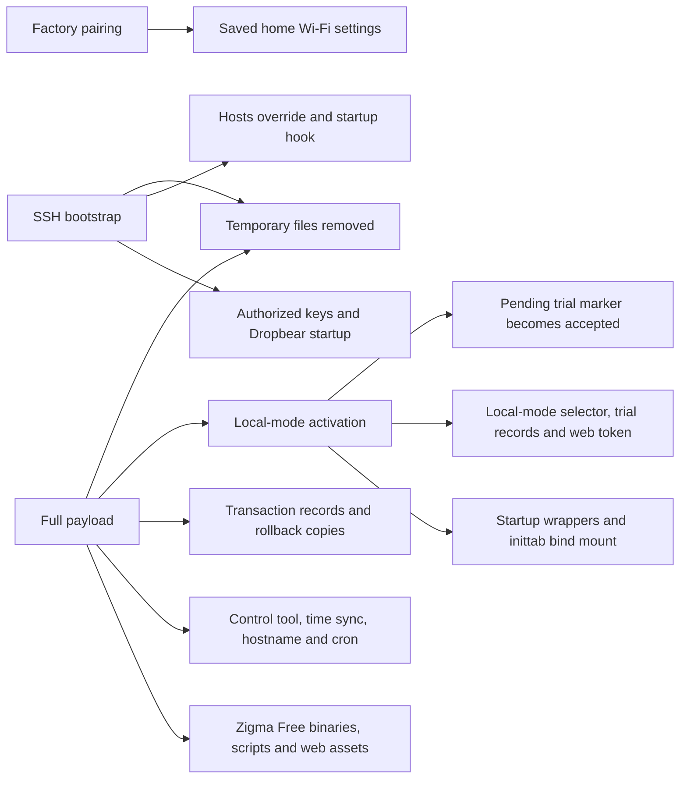

# Installer internals and build

For the installation steps, see [Install Zigma Free](README.md).

## Computer scripts

| Script | What it does |
| --- | --- |
| `start-linux.sh`, `start-windows.cmd`, `run-windows.cmd` | Start the wizard and prepare its Python environment using `requirements-wizard.txt`. |
| `wizard.py` | Checks the package and network, guides pairing, verifies SSH access, and runs the local-mode activation checks. |
| `installer.py` | Builds the per-robot installation script and payload. It reads `known-firmware.json` to generate the firmware checks. |
| `send_pairing.py` | Builds and sends the pairing request that tells the robot where to download the installer. |
| `hosts_guard.py` | Uses SSH to apply the robot-side hostname overrides. |
| `nor_backup.py` | Downloads the flash backup and verifies it against a second read. |
| `session_recovery.py` | Continues an interrupted installation using its saved session. |
| `console_output.py`, `ssh_output.py` | Format console and SSH diagnostics. |

These files live in [computer/](computer/) and run from the extracted deployment archive. The launchers create `.wizard-venv/` beside the scripts, and the wizard saves session files under `~/Zigma/`.

## Robot scripts

Source paths are relative to [robot/](robot/). Entries in `bundle.tar.gz` are relative to the archive root. On the overlay layout, the stack is stored under `/root/firmware/arobot/zigma-free` and exposed at `/root/zigma-free`.

| Source script | Source package or transfer | Target on the robot | What it does |
| --- | --- | --- | --- |
| `install.sh.in` | Generated as `install.sh` for SSH bootstrap, then as `full-install.sh` on the computer for the full stage | The factory downloader runs the bootstrap script. The wizard uploads the full script as `/tmp/zigma-full.*/install.sh`. | Checks firmware and storage, enables SSH, and stages the full installation on compatible firmware. |
| `activate.sh` | `bundle.tar.gz` → `stack/activate` | `/root/zigma-free/activate` | Starts and checks the local-mode trial and handles acceptance or rollback. |
| `storage.sh` | `bundle.tar.gz` → `init/S02zigma-storage` | `/root/etc/init.d/S02zigma-storage` on the overlay layout | Sets up the storage paths used by Zigma Free. |
| `configure-support.sh` | `bundle.tar.gz` → `support/configure-support.sh` | Sourced from `/tmp/zigma-install.*/payload/support/` during installation | Installs supporting startup hooks and tools from the payload. |
| `vendor-hosts.sh` | Uploaded separately over SSH by `hosts_guard.py` | Runs as `/tmp/zigma-hosts-pc.*/apply.sh`. Writes persistent files under `/root/.zigma-hosts/` and the hook `/root/etc/init.d/S03zigma-hosts`. | Applies and persists overrides for known vendor hostnames. |
| `init/S98zigma-free` | `bundle.tar.gz` → `init/S98zigma-free` | Staged under `/root/zigma-free/install-init/`, then installed at `/root/etc/init.d/S98zigma-free` during activation | Starts the Zigma Free services. |
| `init/S01time`, `init/S03zigma-hostname`, `init/S96ntpsync`, `init/S97crond` | `bundle.tar.gz` → `support/` with the same filenames | `/root/etc/init.d/` | Boot hooks for time, hostname, network time sync, and cron. |
| `src/zigma-cron`, `src/zigma-free-service`, `src/zigma-mode`, `src/zigma-mode-backend`, `src/zigma-settings` | `bundle.tar.gz` → `stack/` with the same filenames | `/root/zigma-free/` | Scheduling, service supervision, mode switching, and settings. |
| `src/zigma-time-sync` | `bundle.tar.gz` → `support/zigma-time-sync` | `/root/bin/zigma-time-sync` | Synchronises the robot's clock. |

## Compiling and packaging

See [src/README.md](../src/README.md) for the toolchain, per-component build commands, and Telegram transport build. Run `python3 src/package-release.py --label dev` from the repository root after building both sets of binaries.

The packager puts the ARM executables and transport assets in `robot/build/`, third-party notices in `robot/vendor/`, the version inventory in `robot/versions.json`, and web assets in `web/src/` inside the archive. It writes ZIP and TAR.GZ archives with SHA-256 sidecars. The wizard checks the internal `SHA256SUMS` before starting an installation.

The generated archives use launchers under `computer/`. The original V1.0 archives use launchers at the archive root.

## Full installation walkthrough

This is the sequence for a new installation with the Windows or Linux wizard. Commands and paths in this section describe what the wizard runs automatically.

### 1. Check the package and prepare the session

The launcher creates or reuses a Python virtual environment and installs the required dependencies if they are missing. The wizard verifies the distribution files against `SHA256SUMS` and looks for exactly one usable home Wi-Fi IPv4 address. It saves the network profile so the computer can reconnect after visiting the robot's pairing network. The address also goes into the download URLs sent to the robot.

For a new installation, the wizard asks for a robot name, Wi-Fi network, and password. It creates a timestamped folder under `~/Zigma`, generates an ECDSA P-256 SSH key pair, and saves two scripts and the full payload. The first script requests the SSH-only profile. The second requests the full profile and contains the expected payload SHA-256. The payload carries a checksum list for its individual files.

### 2. Start the local server and pair the robot

The wizard serves the SSH entry script and the full payload on TCP port 8000 by default. It supports HTTP and HTTPS on that port and checks that both return the expected entry script locally. The server stays available while the computer switches Wi-Fi networks.

When the computer joins the robot's pairing access point, the wizard checks whether SSH is already available at `192.168.99.1`. If a saved session has a matching pinned host key and can authenticate, the wizard applies the vendor hostname overrides before pairing. Otherwise, it reports that those overrides will be applied after SSH is set up. A first home Wi-Fi connection can therefore happen before the overrides are in place.

The wizard sends one pairing request using the Redmond profile. The request supplies the home Wi-Fi settings, the entry script URL, and the script's MD5 for the factory downloader. The computer returns to its saved home Wi-Fi profile, and the wizard waits for its original IPv4 address. It identifies the robot from the peer that downloads the entry script. It stops if more than one peer downloads it.

### 3. Enable and verify SSH

The downloaded script runs on the robot. It checks the ARM environment, the boot chain, Dropbear, and persistent storage. It takes an installation lock, records a pending transaction, adds the session public key alongside any existing keys, and installs the Dropbear startup hook. It starts SSH and records the completed profile.

The computer authenticates using the new key, pins the robot's host key, and checks that the transaction completed. It saves the SSH address in `connection.txt`. It then uploads and verifies `vendor-hosts.sh` over SSH. The script preserves the original hosts file and installs persistent loopback overrides for known vendor hostnames. Direct IP connections remain possible.

### 4. Back up the flash

Over pinned SSH, the wizard uploads a temporary NOR reader and verifies its SHA-256 before running it. The reader streams the complete 32 MiB flash image. The wizard saves the first read and compares it against a second complete read. On success, it keeps `nor-backup.bin` and `nor-backup.json` in the session folder. This live backup includes the SSH and hostname changes made by the earlier stages.

If the reads differ, the wizard can repeat both reads from the beginning. If verification still fails, it keeps any captured bytes marked as unverified. The default is to stop. Continuing without a verified backup requires explicit confirmation and working pinned SSH. The firmware checks still apply.

### 5. Stage the full installation

The wizard uploads the full installer over SSH to a temporary directory and verifies the script's SHA-256 before running it. The script checks the flash layout, firmware hashes, mount points, available space, and existing files. If firmware compatibility cannot be established and SSH is supported, the effective result can remain SSH-only.

For a compatible full installation, the robot downloads the payload from the computer, verifies the archive SHA-256, and checks the extracted files against the internal manifest. The installer stages the binaries, web assets, and supporting scripts on the writable storage appropriate to the robot's layout. On the overlay layout, a storage hook exposes the stack at `/root/zigma-free`. The installer saves the vendor startup hooks and original `inittab`, prepares time, hostname, and cron support, and records the completed profile and bundle hash. At this point the full stack is staged. The switch to local mode happens in the next stage.

### 6. Trial and accept local mode

The wizard first verifies the full completion marker, the bundle hash, and the absence of a pending installation transaction. It then runs `activate start`. The robot records the current boot ID and starts an independent 240-second rollback timer. The startup hooks and local-mode selector let Zigma Free take over from `ygclient` and the factory `daemon`, while the factory navigation and app-server processes remain in use.

The computer has up to 90 seconds to verify pinned SSH, the pending trial state, the local control queue, and an authenticated response from `/api/status` on port 8765. These checks issue no cleaning command. If they pass, the wizard runs `activate accept`. The robot checks that the trial is still valid, the local services are healthy, the vendor client and supervisor are stopped, and the web service responds locally. The wizard confirms the accepted state, shows the access token, and offers to open the dashboard. It saves the dashboard URL in `connection.txt` and closes the temporary server.

### 7. Recover if activation is interrupted

An unaccepted trial expires back to vendor mode. A boot check also clears an interrupted trial on the next boot. The wizard records failed checks in `trial-failure-*.json` in the computer's session folder. If SSH is still unreachable after the check window, it can ask for a manual restart and retry activation once after verifying the new boot and pinned SSH identity. The wizard does not send a reboot command.

A saved session reuses the robot address, key, and host pin. It checks the hostname overrides and verifies the saved backup or attempts a new one if needed. If the matching full payload is already staged, it retries activation only once the previous trial has recovered. If only SSH was completed, it verifies that the payload matches the saved session before continuing. Pairing is skipped in both cases.

## Files changed on the robot

This inventory describes a successful new full installation through acceptance of local mode. Paths under `/root/zigma-free/` are the runtime paths. On the overlay layout, the stack is stored under `/root/firmware/arobot/zigma-free/` and exposed through a bind mount. Startup files and settings marked **Added or updated** may already exist on some firmware versions.

| Change | Files or directories | What the installer does |
| --- | --- | --- |
| Added or updated by pairing | `/root/yg/etc/wpa_supplicant.conf` | The factory pairing handler saves the home Wi-Fi settings before the robot downloads the entry script. |
| Added or updated | `/root/.ssh/authorized_keys`, `/root/etc/init.d/S98dropbear` | Adds the session public key alongside existing keys and configures the built-in Dropbear server to start at boot. Dropbear can generate host keys on first use. |
| Added or updated | `/root/bin/zigmactl`, `/root/bin/zigmactl-LICENSE-cJSON.txt`, `/root/bin/zigma-time-sync` | Installs the local control utility, its licence notice, and the time-sync helper. |
| Added or updated | `/root/hostname`, `/root/.profile`, `/root/etc/crontabs/root` | Saves the selected hostname, adds the shell prompt setup, and adds the time-sync job while keeping existing cron entries. |
| Added or updated | `/root/etc/init.d/S01time`, `S03zigma-hostname`, `S96ntpsync`, `S97crond` | Installs the time, hostname, network time sync, and cron startup hooks. All four files are under `/root/etc/init.d/`. |
| Replaced with wrappers | `/root/etc/init.d/S70yg`, `/root/etc/init.d/S99daemon` | Installs mode-aware wrappers that skip the factory client and supervisor in local mode. The original scripts are saved under `/root/zigma-free/vendor-init/`. |
| Added | `/root/etc/init.d/S03zigma-hosts`, `S98zigma-mode`, `S98zigma-free` | Adds startup hooks for hostname overrides, the mode selector, and the local services. The overlay layout also adds `/root/etc/init.d/S02zigma-storage`. |
| Bind-mounted | `/etc/hosts`, `/etc/inittab` | The live paths show `/root/.zigma-hosts/hosts` and `/root/zigma-free/inittab.local`. The underlying files are preserved. Copies are saved as `/root/.zigma-hosts/hosts.original` and `/root/zigma-free/vendor-init/inittab.original`. |
| Added | `/root/zigma-free/` | Installs `free-zigma-agent-arm`, the `zigma-*-arm` components, `activate`, the mode and service scripts, web assets in `src/`, licence notices, and the bundled Telegram transport assets. |
| Added | `/root/zigma-free/device.conf`, `release.json`, `installer-bundle.sha256`, `installer-layout`, `install-init/` | Records the robot name, the installed component inventory, the bundle hash and layout, and the staged service startup hook. All paths in this row are relative to `/root/zigma-free/` unless shown as absolute. |
| Added for application data | `/root/zigma-free/data/`, `/root/zigma-free/songs/`, `/root/zigma-free-master-maps/` | Prepares directories for application data and songs. On the overlay layout, the master-map directory is exposed from `data/master-maps/` through a bind mount. |
| Created during activation | `/root/zigma-free/local-mode.lock`, `/root/zigma-free/activation/`, `/root/zigma-free/data/access.token` | Records the local-mode selector, trial state and logs. The web service creates its access token if needed. |
| Added for rollback | `/root/.zigma-install/lock`, `/root/.zigma-install/transaction-*/` | Retains transaction records, saved copies of replaced files, rollback scripts, and completion markers. |
| Removed or renamed during cleanup | `/tmp/zigma-install.*`, `/tmp/zigma-full.*`, `/tmp/zigma-hosts-pc.*`, `/tmp/zigma-backup.*`, `/root/.zigma-install/pending`, `/root/zigma-free/activation/pending-boot` | Removes temporary installers, payloads, and the backup reader. Clears the pending transaction marker on success and renames the pending trial marker to `accepted`. |
| Factory files deleted | None by the Zigma Free install scripts | The original factory executables remain on disk. Zigma Free disables `ygclient` and `daemon` in local mode through the startup wrappers. |

### Where the changes land

